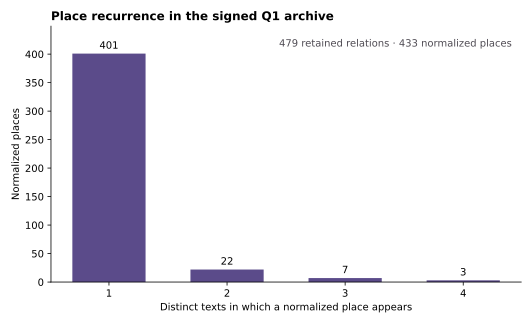
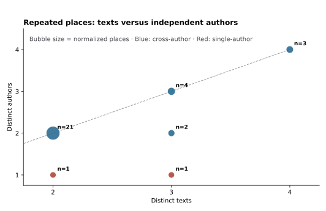

# RQ1 author-concentration check

## Purpose

This check asks whether repeated places in the signed Q1 archive are created by one prolific author rather than shared attention across writers. It uses the 479 text-place relations signed `保留` on 2026-10-25. Eight signed `暂停` relations are excluded before every calculation.

The unit for recurrence is a normalized place appearing in distinct texts. The key control is the number of distinct authors associated with each repeated place. Raw relationship rows are not used as a visibility ranking because a text rich in named locations can contribute many rows.



## Result 1: a long tail remains after sign-off

The retained layer contains 433 normalized place entities. Of these, 401 occur in one text only, 22 occur in two texts, seven occur in three texts, and three occur in four texts. There are therefore 32 repeated entities in the retained layer, not a single dominant destination.



## Result 2: recurrence is mostly cross-author

Thirty of the 32 repeated entities are associated with at least two authors. Only two repeated entities are generated by one author alone: Amman and Baghdad, both in Tang Shizeng's texts. Treating only cross-author recurrence as visibility leaves 30 repeated entities.

## Result 3: raw relation volume is author-concentrated, but the central recurrence result survives

The ten highest-volume authors account for 41.5% of retained relation rows. This is why all Q1 claims should report author count alongside text count. A leave-one-author-out test removes every relation by one author in turn: the number of repeated places remains between 24 and 32. No individual author produces the entire repeated-place pattern.

## Interpretation

The strongest current claim is not that the archive identifies a single canonical Chinese travel destination. It identifies a broad long tail of named places and a smaller set of recurrent places that are usually visible across writers. This is a conclusion about the signed, deliberately constructed archive. It is not a population estimate for all Chinese travel writing between 1980 and 2025.

## Reproduction

Run the public-release builder from the private signed workbook:

```bash
python3 scripts/build_q1_author_concentration_release_20261025.py \
  --workbook /path/to/RQ1_Q1关系语义_人工签署状态回填_20261025.xlsx \
  --output-dir data/public \
  --figure-dir docs/figures
```

The release contains `rq1_author_concentration_sensitivity.csv`, `rq1_leave_one_author_out.csv`, and `rq1_author_concentration_summary.json`. They contain counts only; no full text, quotation, source URL, or evidence locator is released.
