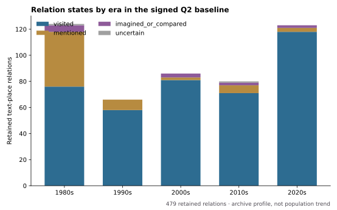
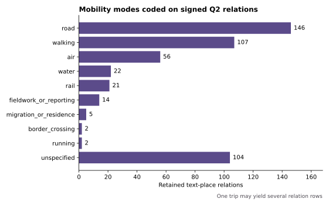

# RQ2 mobility and narration baseline

## Question and scope

How do authors narrate mobility in the current Chinese-language travel-writing archive?

This release uses the 479 text-place relations signed `保留` on 2026-10-25. It treats a relation as a coded link between one text and one named place. It does **not** treat every relation as a separate trip, reconstruct an itinerary from disconnected places, or estimate mobility in all Chinese travel writing between 1980 and 2025.

Eight signed `暂停` relations are excluded before every calculation. The bibliographic `related` layer is not used: it has no full-text relation status or mobility coding.



## Result 1: mobility analysis begins with a distinction between arrival and reference

Of the retained relations, 404 are `visited` (84.3%). The remaining 75 are 61 `mentioned`, 12 `imagined_or_compared`, and two `uncertain`. RQ2 therefore does not reduce every geographic reference to a movement event: `mentioned` and `imagined_or_compared` belong to the cultural-reference layer, not the arrival layer.

## Result 2: most arrival relations carry an explicit mode code

Of 404 retained `visited` relations, 369 (91.3%) have a mode other than `unspecified`. The largest coded categories are road (144 visited relations), walking (106), and air (56), followed by water (21) and rail (20). Reporting/fieldwork (14), migration or residence (five), border crossing (one), and running (two) remain distinct because they describe different narrative situations rather than interchangeable transport types.



These counts identify how movement is *attached to narrated places* in this archive. A multi-stop journey can create several road or walking relations, so the figure does not show the modal share of trips or passengers.

## Result 3: ordered nodes provide a bounded narrative-sequence layer

Seventy-eight texts contain at least one numeric route-order field. Sixty-nine contain two or more distinct ordered nodes, supporting 160 conservative adjacent narrative transitions. These transitions preserve textual ordering for future close reading. They are not a verified road, rail, aviation, or migration network: no edge is inferred unless the text coding supplies adjacent narrative order.

## What this answers now

The signed archive supports a defensible descriptive answer: authors write mobility chiefly through arrived-at places with explicit mode coding, while a smaller but analytically separate set of places functions as reference, comparison, or imagination. The current material can compare these coded layers within the archive and select ordered cases for close reading.

It does not yet support a finished claim about which *themes* are associated with which places across every era. That next stage requires a consistent text-level theme and narrative-function codebook across all 107 texts, followed by manual review of selected text-place cases. Topic modelling or a network visualisation alone would not supply that interpretation.

## Reproduction

Run the public-release builder against the private signed workbook:

```bash
python3 scripts/build_q2_mobility_baseline_release_20261025.py \
  --workbook /path/to/RQ1_Q1关系语义_人工签署状态回填_20261025.xlsx \
  --output-dir data/public \
  --figure-dir docs/figures
```

The release publishes aggregate counts only. It contains no full text, quotation, evidence location, title, author, or source URL.
