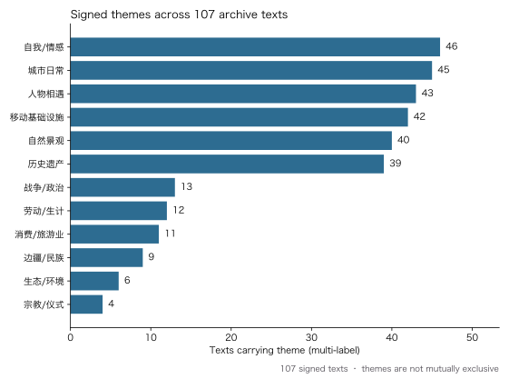
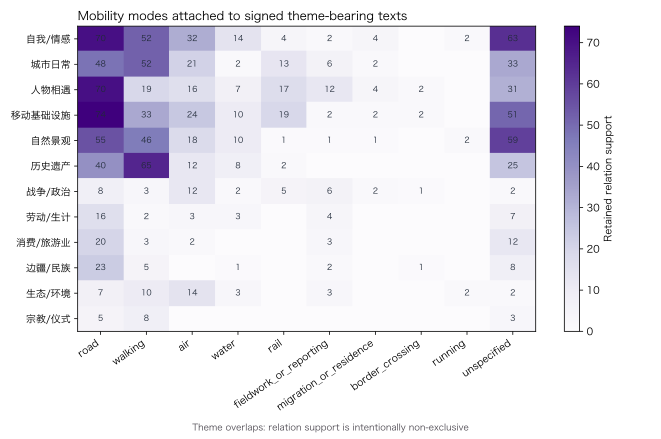

# RQ2 signed theme, place-state, and narration profile

## Question and unit of analysis

This release asks how the current archive connects thematic emphasis, narrated places, and mobility. It joins one human-signed theme set (one to three themes) and one signed primary narrative function for each of 107 canonical texts to the separately signed retained text-place relation layer (479 relations).

The unit remains a text-place relation. A theme is coded on its parent text, then inherited by that text's retained relations for aggregation. A relation therefore contributes once to every signed theme on its parent text. Theme counts are deliberately non-exclusive; they are not shares of journeys, causal effects, or a population trend for Chinese travel writing as a whole.

One signed text has no retained relation because its relation rows are paused. It remains in the 107-text theme and narrative denominator, but adds zero relation support. The bibliographic `related` layer is not used.



## Result 1: six thematic registers recur across roughly two-fifths of the archive

The most frequent signed themes are self/emotion (46 of 107 texts, 43.0%), city daily life (45, 42.1%), encounters (43, 40.2%), mobility infrastructure (42, 39.3%), natural scene (40, 37.4%), and heritage (39, 36.4%). This is not a single-topic archive: the 107 texts contain 310 signed theme labels, and each text may carry up to three.

When linked to the 479 retained text-place relations, self/emotion has 243 relations of support (50.7% of the relation denominator), mobility infrastructure 217 (45.3%), natural scene 193 (40.3%), encounters 178 (37.2%), city daily life 177 (37.0%), and heritage 152 (31.7%). These support counts show how many coded places occur in texts carrying a theme; they do not rank the intrinsic importance of themes or places.

## Result 2: mobility is usually a way of structuring a text, not only a transport variable

`移动行程` is the signed primary narrative function for 43 texts (40.2%), followed by `现场观察` for 26 (24.3%), `新闻/田野报道` for 14 (13.1%), and `mixed` for 11 (10.3%). The remaining functions are encounter (five), memory/stay (six), and historical-cultural interpretation (two). Because narrative function is single-valued while theme is multi-label, this tells us which textual operation organizes a piece rather than which topic it contains.



Road and walking relation codes recur across the high-frequency themes, but the matrix is not a modal split of independent trips. For example, a relation in a text signed both `自然景观` and `自我/情感` legitimately appears in both rows. The matrix is useful for selecting comparable close-reading cases, not for claiming that a mode causes a theme.

## What Q2 can now answer

Within this signed archive, cultural imagination is not separable from movement: routes and walking are recurrent resources through which authors organize sensory self-reflection, city observation, encounters, landscape, and heritage. The archive now supports reproducible comparisons among these signed registers, place states, mobility codes, and narrative functions.

It still does **not** establish the distribution of themes in all Chinese travel writing from 1980 to 2025, reconstruct actual itineraries, or infer a transportation network. The public release contains aggregate counts only, without texts, titles, authors, quotations, source URLs, or relation-level evidence.

## Reproduction

Run the public-release builder against the two private signed workbooks:

```bash
python3 scripts/build_q2_theme_narration_release_20261025.py \
  --relations-workbook /path/to/RQ1_Q1关系语义_人工签署状态回填_20261025.xlsx \
  --theme-workbook /path/to/RQ2_主题叙事功能_统一编码与人工签署_20261025.xlsx \
  --output-dir data/public \
  --figure-dir docs/figures
```

The generated outputs are `rq2_theme_narration_summary.csv`, `rq2_theme_by_era.csv`, `rq2_theme_mobility_matrix.csv`, `rq2_theme_place_state_matrix.csv`, and `rq2_theme_narration_summary.json`.
