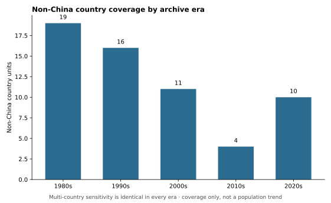
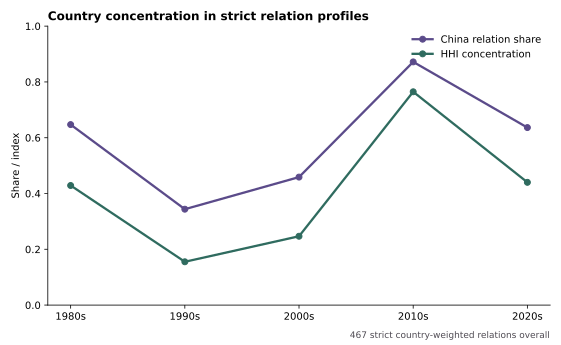
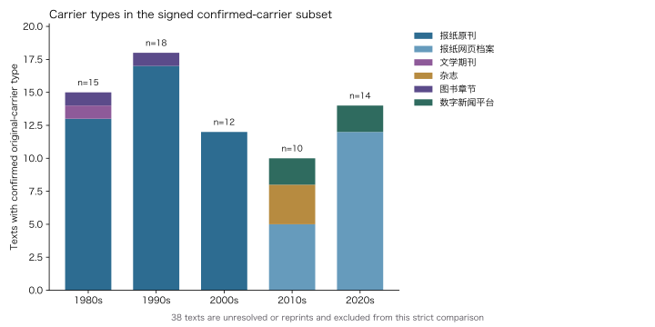

# RQ3 country coverage and concentration profile

## Question and signed scope

Does the geographic world of the current archive expand across eras, or remain concentrated in a small number of country units?

This release starts with the 479 Q1-signed retained text-place relations and a project-lead-signed treatment for all 53 raw `country/region` values. China, Hong Kong, and Taiwan are combined as `中国` under the project boundary; the two historical German labels are combined as Germany for current-country coverage. Historical polities, supra-national regions, missing country fields, and multi-country relations are not silently converted into weighted country observations.

The strict concentration denominator is 467 relations. Twelve are excluded from country weighting: five missing values, one historical polity, three supra-national regions, and three multi-country relations. Multi-country relations are added only to a coverage sensitivity check, never given invented fractional relation weights.



## Result 1: the archive does not show monotonic geographic expansion

Strict non-China country coverage is 19 units in the 1980s, 16 in the 1990s, 11 in the 2000s, four in the 2010s, and 10 in the 2020s. The multi-country sensitivity produces the identical count in every era. In this archive, the later recovery does not restore the earlier breadth, and the sequence is plainly non-monotonic.

This is a finding about the frozen archive—not a claim that Chinese travel writing as a whole became less global. The eras contain similar numbers of texts but different publication, digitisation, access, and selection histories. Country coverage is therefore a descriptive profile and an audit signal for future corpus expansion.

## Result 2: breadth and concentration coexist, but unevenly

Across all eras, 43 strict country units occur in the 467 country-weighted relations. China accounts for 60.6% of those relations; the top three country units account for 70.0%. The country-distribution HHI is 0.376 and its Gini coefficient is 0.770, both indicating a concentrated relation profile.



Concentration is not constant: the 1990s are the broadest and least concentrated profile (17 country units; China share 34.4%; HHI 0.155), while the 2010s are the narrowest and most concentrated (five country units; China share 87.2%; HHI 0.765). The `visited`-only sensitivity preserves this contrast: China shares are 32.1% and 89.9% respectively. Therefore the pattern is not produced solely by places that are mentioned, imagined, or compared rather than arrived at.

## What this answers—and what it does not

The archive supports a bounded answer: its geographic world is not a steadily widening sequence, and its country-level relation profile is concentrated, with large variation by era. It supports selecting the especially broad 1990s and narrow 2010s for subsequent close reading.

It does **not** identify a geopolitical “core” and “periphery.” That claim needs a separately specified and signed theoretical classification, rather than treating high frequency as geopolitical centrality. Nor does it establish a historical population trend or count actual journeys.

## Confirmed-carrier profile: a conditional media comparison

All 107 texts now have project-lead-signed carrier coding. Sixty-nine have a confirmed original-carrier category and enter the strict media subset; 38 are original-carrier unresolved or available only via a reprint page, so are excluded rather than guessed.



Within the confirmed subset, the 1980s, 1990s, and 2000s are dominated by newspaper originals (13 of 15, 17 of 18, and 12 of 12 strict-carrier texts). The 2010s contain five newspaper web-archive texts, three magazine texts, and two digital-news texts; the 2020s contain 12 newspaper web-archive texts and two digital-news texts. This identifies a change in the archive's confirmed carrier *forms*, but not a market-wide transition from print to digital: a newspaper web archive can preserve a print-origin text, and strict-carrier coverage varies from 85.7% of 1990s texts to 50.0% of 2010s texts.

The carrier result is therefore conditional, not a claim about the whole historical publishing ecology. It is nevertheless usable for future sampling: the second corpus batch should specifically recover original carriers for the 38 unresolved/reprint cases and add independently verified magazine, book-chapter, and digital-native texts.

## Reproduction

```bash
python3 scripts/build_rq3_expansion_concentration_release_20261026.py \
  --relations-workbook /path/to/RQ1_Q1关系语义_人工签署状态回填_20261025.xlsx \
  --scope-workbook /path/to/RQ3_世界扩张与集中度_地理单元签署_20261025.xlsx \
  --output-dir data/public \
  --figure-dir docs/figures
```

The public aggregates are `rq3_country_coverage_by_era.csv`, `rq3_country_concentration_by_era.csv`, `rq3_country_concentration_sensitivity.csv`, `rq3_country_summary.json`, `rq3_carrier_coverage_by_era.csv`, `rq3_carrier_distribution_by_era.csv`, `rq3_carrier_relation_support_by_era.csv`, and `rq3_carrier_summary.json`.
